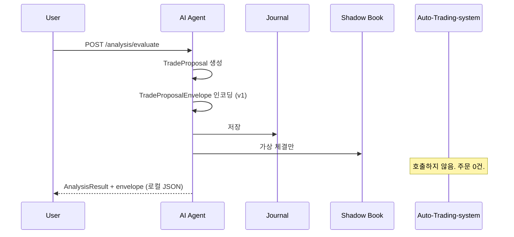
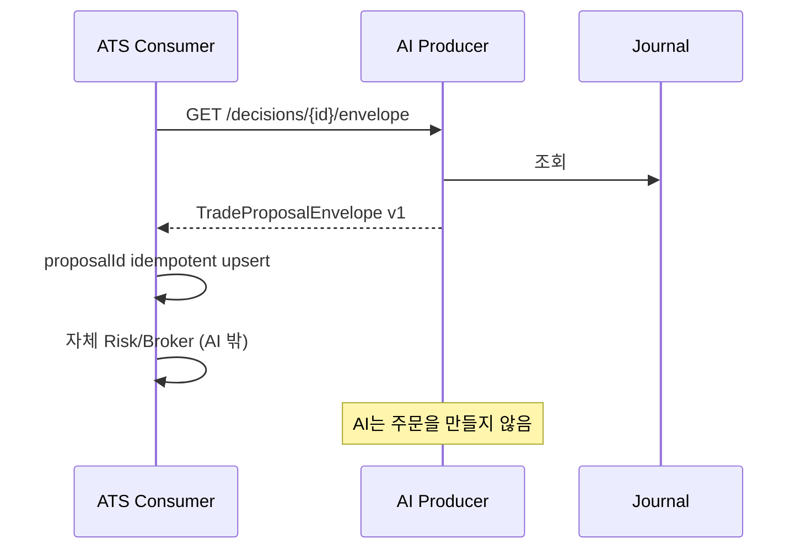
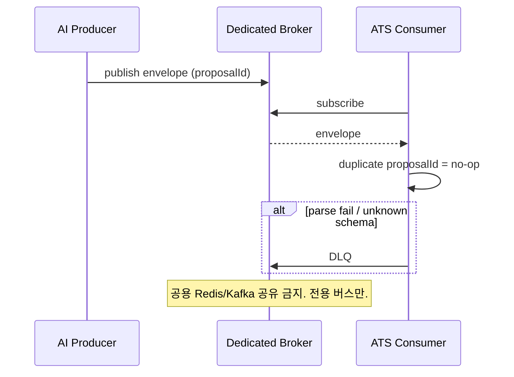
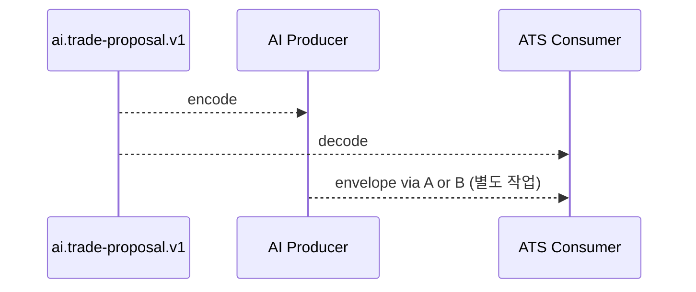

# 향후 통합 Contract

이 문서는 AI Investment Judgment Agent와 Auto-Trading-system이 **나중에** 통신할 수 있도록 계약을 고정합니다.

**이 단계에서 실제 연결은 하지 않습니다.** Auto-Trading-system 저장소 수정, API 호출, DB/Redis 공유, PAPER/REAL 주문, 실제 주문 테스트는 모두 금지이며 수행하지 않았습니다.

역할:

- AI Agent = **TradeProposal Producer**
- Auto-Trading-system (향후) = **TradeProposal Consumer**

전달물은 `TradeProposalEnvelope`입니다. **주문이 아닙니다.**

현재 schemaVersion: `ai.trade-proposal.v1`

---

## 1. Contract

Producer는 내부 `TradeProposal`을 아래 envelope로만 노출합니다. Consumer는 envelope를 읽고 자체 리스크/주문 계층에서 따로 판단합니다. Envelope를 주문으로 승격하는 필드는 없습니다.

```
TradeProposalEnvelope {
    schemaVersion          # const: "ai.trade-proposal.v1"
    proposalId             # idempotency key (= decisionId)
    generatedAt

    ticker
    market                 # v1: "KRX"

    horizon                # LONG_TERM | SHORT_TERM | NONE
    action                 # BUY | SELL | HOLD | NO_TRADE | TACTICAL_WAIT | EXIT_REVIEW

    confidence             # 0..1
    confidenceSource       # RAW | CALIBRATED
    expectedReturn         # decimal string
    estimatedRisk          # decimal string, >= 0

    suggestedCapitalPct    # 0..100, AI 할당 가능 자본 대비 권고. 주문 수량이 아님

    thesis { headline, summary, bullCase, bearCase, drivers, invalidations }
    invalidationConditions [{ code, description }]
    reasonCodes

    modelVersion
    featureVersion
    policyVersion

    artifactType           # const: "TRADE_PROPOSAL"
    isOrder                # const: false
    producer               # const: "ai_investment_agent"
    intendedConsumer       # const: "future_auto_trading_system"
}
```

JSON Schema: `src/ai_investment_agent/contracts/schemas/ai.trade-proposal.v1.json`

Pydantic encoder: `TradeProposalEnvelope.from_proposal` / `envelope_from_proposal`.

규칙:

- `confidence`는 `calibratedConfidence`가 있을 때만 그 값이고, 없으면 `rawConfidence`입니다. calibrated 값을 지어내지 않습니다. `confidenceSource`가 출처를 표시합니다.
- `NO_TRADE` / `TACTICAL_WAIT`의 `suggestedCapitalPct`는 0입니다.
- quantity, price, accountId, brokerOrderId 필드는 **존재하지 않습니다.**
- `isOrder`는 항상 `false`이며 `true`로 설정할 수 없습니다.

Idempotency: Consumer는 `proposalId`가 같으면 동일 판단으로 보고 재처리해도 효과가 같아야 합니다.

---

## 2. Schema Versioning

| 항목 | 값 |
| --- | --- |
| Family | `ai.trade-proposal` |
| 현재 | `ai.trade-proposal.v1` |
| 다음 breaking | `ai.trade-proposal.v2` |

`schemaVersion`은 `modelVersion` / `featureVersion` / `policyVersion`과 분리됩니다.

- `schemaVersion`: 와이어 계약 (필드 이름, 타입, 의미)
- `modelVersion`: 판단 모델 핀
- `featureVersion`: 피처 엔진 핀
- `policyVersion`: AI-side policy 핀

Producer는 현재 지원 목록에 있는 schema만 emit합니다. 이 저장소의 지원 목록은 `v1` 하나뿐입니다.

---

## 3. Compatibility Policy

1. **Unknown schemaVersion은 거부.** `ai.trade-proposal.v2`를 모르는 v1 consumer는 문서를 버려야 합니다. 침묵 파싱 금지.
2. **같은 major 안 additive optional field는 호환.** v1 consumer는 모르는 키를 **ignore**합니다 (forward compatible). Producer emit은 `additionalProperties: false`로 엄격합니다.
3. **필드 삭제, 이름 변경, 타입 변경, 의미 변경은 breaking.** 새 `ai.trade-proposal.vN`이 필요합니다.
4. **const 값 변경은 breaking.** 예: `isOrder`를 true로 바꾸거나 `artifactType`을 ORDER로 바꾸는 것은 새 스키마가 아니라 **다른 계약**입니다. 이 프로젝트는 그 계약을 만들지 않습니다.
5. **Idempotency key = `proposalId`.** 재시도는 같은 envelope를 다시 넣는 것으로 충분합니다.
6. **이 정책은 Auto-Trading-system 연결을 포함하지 않습니다.** `autoTradingSystemConnected = false`.

코드: `CompatibilityPolicy` / `parse_producer_envelope` / `parse_consumer_envelope`.

---

## 4. Integration Architecture Proposal

실제 연결은 하지 않습니다. 아래는 **나중에** 고를 수 있는 비교입니다.

권장 조합 (미래, 별도 작업): **Option C로 계약을 공유하고, 전달은 Option B, 재조회/리플레이는 Option A.** 지금은 셋 다 구현하지 않습니다.

### Option A — REST API

AI가 envelope를 HTTP로 제공합니다. ATS가 pull 합니다.

장점: 운영이 단순, 재조회/리플레이가 쉽고, 방화벽 친화적, 현재 Analysis API와 형태가 맞음.

단점: ATS가 polling하거나 AI 가용성에 결합됨. AI 장애 시 consumer가 새 판단을 못 받음. Push 지연.

복잡도: 낮음 (인증, 페이징, since 커서 정도).

장애 격리: AI 다운 → 신규 proposal 중단. 기존 ATS 주문 경로는 그대로여야 함 (AI는 주문을 안 함).

재시도: HTTP 재시도 + `proposalId` idempotency. at-least-once pull은 중복 envelope를 no-op.

Idempotency: `GET`은 자연스럽게 멱등. Consumer upsert by `proposalId`.

향후 확장성: 구독/팬아웃이 약함. 여러 consumer가 생기면 polling 부하.

### Option B — Message Broker

AI가 envelope를 토픽에 publish. ATS가 subscribe.

장점: 비동기, 팬아웃, AI와 ATS 런타임 분리, backpressure.

단점: 브로커 운영, 스키마 레지스트리, poison message, 순서. **지금 단계의 Redis/Kafka 공유 금지**와 충돌하므로 별도 클러스터여야 함.

복잡도: 중~높음.

장애 격리: 가장 좋음. AI 또는 ATS 한쪽이 죽어도 브로커에 남음. 공유 Redis를 쓰면 격리가 깨지므로 금지.

재시도: consumer retry + DLQ. at-least-once가 기본. 중복은 `proposalId`.

Idempotency: 필수. 브로커 재전달을 `proposalId`로 흡수.

향후 확장성: 여러 consumer, replay topic, schema evolution에 유리.

### Option C — Shared Contract Package

언어 중립 JSON Schema + (선택) 버전된 패키지. 전송은 A 또는 B.

장점: Producer/Consumer 파서 불일치 감소, schemaVersion을 코드로 고정, 이번 산출물과 직접 대응.

단점: 패키지 배포/버전 동기화. 전송 계층은 따로 필요. 패키지 버전이 schemaVersion과 어긋나면 혼란.

복잡도: 낮음 (스키마만) ~ 중간 (멀티언어 SDK).

장애 격리: 런타임 결합 없음. 잘못된 버전을 배포하면 파싱 실패로 드러남 (원함).

재시도: 패키지 자체는 재시도 없음. 전송 계층 책임.

Idempotency: 스키마에 `proposalId`를 계약으로 박음.

향후 확장성: v2 패키지를 나란히 둘 수 있음. **가장 먼저 고정할 층**이며 이번 작업의 범위입니다.

### 비교 요약

| | A REST | B Broker | C Shared Contract |
| --- | --- | --- | --- |
| 장점 | 단순, 재조회 | 격리, 팬아웃 | 파서 일치 |
| 단점 | 결합/폴링 | 운영, 공유 버스 금지 | 전송은 별도 |
| 복잡도 | 낮음 | 중~높음 | 낮음 |
| 장애 격리 | 중 | 상 (전용 버스일 때) | 상 (런타임 무결합) |
| 재시도 | HTTP + proposalId | DLQ + proposalId | 해당 없음 |
| Idempotency | GET/upsert | 필수 | 키를 계약에 고정 |
| 확장성 | 약함 | 강함 | 스키마 진화에 강함 |
| 이번 단계 | 조회 전용 schema GET만 | 구현하지 않음 | **JSON Schema + Pydantic 고정** |

하지 않는 것: ATS repository 수정, ATS API 호출, 공용 DB, 공용 Redis, PAPER/REAL 주문.

---

## 5. Sequence Diagram

### 5.1 현재 (연결 없음)



### 5.2 미래 Option A (제안만, 미구현)



### 5.3 미래 Option B (제안만, 미구현)



### 5.4 미래 Option C + 전송 (제안만, 미구현)



---

## 6. Migration Plan

실제 통합은 **별도 작업**입니다.

| 단계 | 이 저장소 | Auto-Trading-system | 주문 |
| --- | --- | --- | --- |
| **0 지금** | Contract freeze, envelope encode, schema GET | 손대지 않음 | 없음 |
| **1 Consumer stub** | 변경 최소. fixture envelope 샘플 제공 | 별도 브랜치에서 v1 JSON 파서만. 주문 연결 금지 | 없음 |
| **2 Shadow 대조** | Shadow 성과 vs ATS paper book 비교 설계 | PAPER 계좌는 ATS 쪽 책임. 이 repo는 호출하지 않음 | PAPER는 ATS만, 이 프로젝트 금지 |
| **3 전송 선택** | REST pull 또는 전용 브로커. 공용 Redis 금지 | Consumer 구독 | 여전히 AI는 주문 안 함 |
| **4 승인 게이트** | schemaVersion + model/policy pin 검사 | unknown schema reject, proposalId upsert | REAL은 ATS 자체 게이트. AI kill switch는 Proposal only |

승격 조건 (미래):

- v1 consumer 파서가 fixture envelope를 통과
- unknown schemaVersion 거부 테스트
- duplicate `proposalId` no-op 테스트
- Shadow와 판단 품질이 안정
- 온라인 학습 없음 유지

롤백: Consumer가 `ai.trade-proposal.v1`만 받으면 Producer를 되돌려도 계약은 유지됩니다. v2를 켜기 전에 v1 consumer를 강제 업그레이드하지 않습니다.

---

## 조회 전용 HTTP (이 저장소)

연결이 아니라 **계약 문서 제공**입니다.

| Method | Path | 역할 |
| --- | --- | --- |
| GET | `/contracts` | 지원 schema 목록 |
| GET | `/contracts/trade-proposal/v1` | JSON Schema |
| GET | `/contracts/compatibility` | Compatibility Policy |
| GET | `/decisions/{decisionId}/envelope` | 저장된 판단의 v1 envelope |

`POST`로 ATS에 push하지 않습니다. `POST /orders` 계열은 없습니다.
